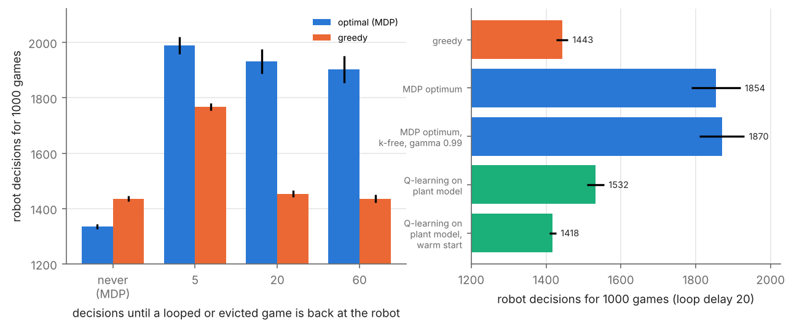

# pnp-warehouse-ssp

A pick-and-place robot sorts board games in three languages (DE, EN, ES) into two intermediate storages of a
**Tecnomatix Plant Simulation** model, or sends them around a conveyor loop. Ten equal games leave a storage as a
batch; a game of another language sends the partial batch back to the loop. Goal: 1000 games as fast as possible.

This repository formulates the robot's decision as a **stochastic shortest-path problem**, solves it exactly, uses
the solution to validate **tabular Q-learning**, connects the agent to the Plant Simulation model (SimTalk methods
+ COM client), and shows what the exact model gets wrong about the plant.
Course project, *Discrete Simulation and Reinforcement Learning*, HSBI, summer term 2026.

**Report:** [`report/report.pdf`](report/report.pdf)

## Results

| | |
|---|---|
| Exact optimum (value iteration, 163,923 states) | expected cost 1965, **14 % below the greedy heuristic** (2289): it evicts small batches where the heuristic loops |
| Q-learning (512 parallel envs, 31 s) | 1966, within 0.06 % of the optimum; 99 % agreement on visited states |
| Discounting | gamma = 0.99 costs 0.03 %; the SSP needs no discount (gamma = 1) |
| **Games come back** (mock of the plant) | the SSP assumes looped/evicted games vanish; when they return, the "optimal" policy needs **up to a third more** robot decisions than the heuristic |
| Merge rule | if returning games have priority at the merge, the robot can be starved of new games and never finish |
| Q-learning on the plant model, warm start from the SSP | the only policy that beats the heuristic there: 1418 vs 1443 decisions, 40 % less spread |



## Layout

```
src/pnpssp/
  mdp.py              state, feasible actions, transition, cost (identities and parameters of the plant model)
  value_iteration.py  exact solver (layered over the batch counter k), policy evaluation, k-free discounted variant
  qlearning.py        tabular Q-learning, vectorised parallel environments (PyTorch)
  environment.py      one interface, two backends: 'python' (the SSP) and 'plantsim' (COM)
  plantsim_com.py     Python side of the decision protocol (pywin32)
  mock_plantsim.py    stand-in for the Plant Simulation model: tests, and games that come back
  policies.py         greedy heuristic, evaluation
plantsim/             SimTalk methods (reset, pnpDecision, GetCurrentState, AIControl, ...) and setup of the model
scripts/              run_benchmark, gamma_sweep, share_sensitivity, recirculation, train_on_plant_model, make_figures
results/ figures/     outputs of the scripts
report/               LaTeX source, tables, PDF
tests/                SSP, solver, COM protocol against the mock
```

The Plant Simulation model file itself is course material and not included; `plantsim/README.md` lists every
setting and method needed to reproduce the control logic in it. The COM backend has not been run against a live
Plant Simulation licence from this repository.

## Reproduce

```bash
pip install -r requirements.txt
python scripts/run_benchmark.py          # optimum, greedy, Q-learning (about 1 min)
python scripts/gamma_sweep.py
python scripts/share_sensitivity.py
python scripts/recirculation.py          # games that come back (a few minutes)
python scripts/train_on_plant_model.py   # Q-learning on the plant model (about 4 min)
python scripts/make_figures.py
pytest -q
cd report && make
```

On Windows with Plant Simulation:

```python
from pnpssp.environment import WarehouseEnv
from pnpssp.plantsim_com import PlantSimClient
env = WarehouseEnv("plantsim", client=PlantSimClient(model_path=r"C:\path\to\Gameboard.spp"))
```
